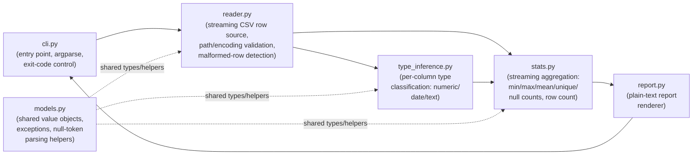

# Architecture: CSV Summary Report Generator

## 1. Component Overview

The system is a single-process, standalone CLI module (`python -m csv_summary`) composed of focused, single-responsibility units. There is no persistence layer, no network I/O, and no third-party runtime dependency. All components operate over a streaming pipeline so that the full file is never materialized in memory (NFR-01, FR-10).

### Component Diagram



### Component Descriptions

| Component | Responsibility | Interfaces |
|-----------|-----------------|------------|
| `cli.py` | Parse CLI arguments (`argparse`), orchestrate the pipeline calls in order, translate exceptions into stderr messages and exit codes via a single top-level `try/except` boundary (FR-01, FR-08, FR-09, NFR-04 — see § 7 Error Handling Taxonomy) | Input: `sys.argv`. Output: process exit code (int); writes to stdout/stderr |
| `reader.py` | Open the file with path/permission validation, detect UTF-8 / UTF-8-with-BOM, stream rows via `csv.reader` without loading the full file, detect field-count mismatches and yield a structured malformed-row marker, provide a cheap "has data rows" pre-check (FR-02, FR-08, FR-09, FR-10, FR-11) | Input: file path (str). Output: generator of `RawRow` (header + an iterator of well-formed/malformed row records) |
| `models.py` | Define shared data classes (`ColumnType` enum, `ColumnStats` variants, `RawRow`/`MalformedRow`), the null-token predicate (FR-04a), and exception types (`CsvFileNotFoundError`, etc.) used across modules | Input/Output: pure data definitions and pure functions; no I/O |
| `type_inference.py` | For each column, sample/stream non-null values and classify as `numeric`, `date`, or `text` using the 90% threshold rule (FR-04); null detection delegated to `models.is_null_token`. A value is counted as numeric only if it parses via `float()` **and** is finite — `NaN`/`Infinity`/`-Infinity` tokens are excluded from the numeric count (treated as unparsable, falling through to `text`). A value is counted as an ISO date only if it first matches a `YYYY-MM-DD` (optionally with a time component) regex guard before being passed to `date.fromisoformat`/`datetime.fromisoformat`, so compact/basic ISO 8601 forms (e.g. `20230115`) are rejected rather than misclassified as dates | Input: stream of rows from `reader`. Output: `dict[str, ColumnType]` |
| `stats.py` | Single streaming pass that, given the column types, accumulates min/max/mean (numeric), unique/null counts (text), earliest/latest/null counts (date), total row count including malformed rows, using constant-memory accumulators (FR-03, FR-05, FR-06, FR-07, FR-11, NFR-01). Numeric accumulation uses `float` internally for all values (mean inherently produces non-integer results in general); non-finite parses (`NaN`/`Infinity`) are treated as null rather than accumulated, consistent with `type_inference.py`'s classification rule. Unique text-value tracking uses an exact, in-memory `set` per text column rather than a probabilistic structure, since FR-06 requires an exact count and a single 100MB file bounds worst-case unique-set memory well under the 512MB budget in practice. Date columns accumulate earliest/latest using the parsed `datetime`/`date` value (date-only values treated as midnight); both date-only and datetime values are classified as `date` | Input: column types + row stream. Output: `(row_count: int, column_stats: dict[str, ColumnStats])` |
| `report.py` | Render the aggregated stats into plain human-readable text, one section per column, no JSON/structured output (FR-12). Numeric values are rendered without a trailing `.0` when the value is whole, otherwise in fixed-point form. Date/datetime earliest and latest values are rendered as `YYYY-MM-DD` unless the column mixes date-only and datetime values, in which case the full `YYYY-MM-DDTHH:MM:SS` form is used to avoid information loss | Input: `row_count`, `column_stats`. Output: `str` |

---

## 2. Data Flow

1. **CLI invocation**: `python -m csv_summary <path-to-csv>` parses arguments via `argparse` in `cli.py`.
2. **Existence/permission/emptiness check**: `cli.py` calls `reader.has_data_rows(path)`, which opens the file (validating it exists and is readable) and determines whether any data row follows the header.
   - Missing file → `CsvFileNotFoundError` → stderr message, exit 1 (FR-08).
   - Permission denied → `PermissionError` → stderr message, exit 1 (FR-08, NFR-04).
   - No data rows (empty file or header-only) → print "No data rows found", exit 0 (FR-09).
3. **Type inference pass**: `type_inference.infer_types(path)` opens a fresh streaming reader (via `reader.py`), reads the header to get column names, then streams data rows, applying the null-token check (FR-04a) and accumulating counts of values that parse as ISO 8601 dates vs. int/float vs. neither, per column. After the stream completes, each column is classified by the 90% thresholds (FR-04). This requires a dedicated pass because classification must be known before per-column aggregation strategy (e.g., numeric vs. date accumulator) can be selected in the next pass.
4. **Statistics pass**: `stats.compute_stats(path, column_types)` opens a second streaming pass over the same file. For each row:
   - If the row's field count differs from the header's, it is counted toward the total row count, a warning is emitted to stderr identifying the row number, and the row is excluded from per-column statistics (FR-11).
   - Otherwise, each cell is parsed per its column's inferred type; unparsable individual values are treated as null for statistics purposes (NFR-03); null/parsed values update the relevant streaming accumulator (running min/max/sum/count for numeric, running min/max date for date columns, a bounded-memory set or count for unique text values, null counters for all types).
   - The accumulators never store row-level data after processing — only O(number of columns) state plus, for text uniqueness, O(number of distinct values) state is retained.
5. **Report rendering**: `report.render(row_count, column_stats)` formats the aggregated results as plain text with one section per column (FR-03, FR-05–FR-07, FR-12).
6. **Output**: `cli.py` prints the rendered report to stdout and returns exit code 0.

### Two-Pass Rationale (Confirmed)
Type inference (step 3) and statistics aggregation (step 4) are two separate streaming passes over the file rather than one, because the aggregation strategy per column (numeric accumulator vs. date accumulator vs. text set) depends on the classification decided only after all non-null values in a column have been observed. Both passes are O(1) additional memory relative to file size (each streams rows one at a time), so two passes over a 100MB file remain within the 512MB RSS budget (NFR-01) at the cost of reading the file twice from disk — an accepted trade-off favoring low, predictable memory over I/O speed. An alternative single-pass approach using a buffered sample of early rows for type inference was considered and rejected: it risks misclassification on files where early rows are unrepresentative, and no latency NFR requires avoiding the second disk read. The two-pass full-column-scan approach is final.

### Malformed Row Numbering (Confirmed)
Row numbers reported in FR-11's stderr warning are 1-indexed over data rows only — the first data row immediately following the header is row 1. This is consistent with FR-03's "total row count," which explicitly excludes the header, avoiding off-by-one ambiguity between the warning message and the reported total.

---

## 3. Technology Choices

| Technology | Purpose | Justification |
|------------|---------|----------------|
| Python >= 3.11 | Runtime | Explicit project constraint (NFR-05); enables modern `csv`, `datetime.fromisoformat` (which in 3.11+ parses the full ISO 8601 spec including `Z` suffix), and structural pattern matching if useful |
| `csv` (stdlib) | Row-level streaming CSV parsing | Built-in, battle-tested comma-delimited CSV reader; used with `csv.reader` (iterator-based) rather than `csv.DictReader`/`pandas` to avoid materializing rows as dicts or a DataFrame, keeping memory bounded (FR-10, NFR-01) |
| `argparse` (stdlib) | CLI argument parsing | Standard, dependency-free CLI parsing with built-in `--help`, matches NFR-05/NFR-06 standalone-module requirement |
| `datetime` (stdlib) | ISO 8601 date parsing for date-column classification and stats | `datetime.date.fromisoformat` / `datetime.datetime.fromisoformat` directly implement the ISO 8601 subset required by FR-04/FR-07 without a third-party dependency |
| `io` + explicit `encoding="utf-8-sig"` fallback logic (stdlib) | UTF-8 / UTF-8-with-BOM detection and transparent BOM stripping | `utf-8-sig` decodes both UTF-8 and UTF-8-with-BOM transparently via the stdlib, avoiding a dependency like `chardet` (FR-02) |
| Streaming/generator-based pipeline (custom, stdlib-only) | Bounded memory while processing up to 100MB files | Row-by-row generators plus fixed-size accumulators (running sum/count/min/max, bounded `set` for uniqueness) ensure peak memory stays within the 512MB budget (FR-10, NFR-01) |
| `pytest` (>=8,<9), `pytest-cov` (>=5,<6) | Test execution and coverage reporting | Test-only dependency declared in the `test` optional-dependency group of `pyproject.toml`; no impact on runtime dependencies or NFR-05 |
| `psutil` (>=5,<6) | Cross-platform peak-RSS measurement for the NFR-01 memory benchmark | Test-only dependency (declared alongside `pytest`/`pytest-cov` in the `test` extra) used by `tests/integration/test_memory_benchmark.py` to poll the subprocess's RSS; replaces the POSIX-only `resource` module so the benchmark also runs on Windows. Has no impact on runtime dependencies or NFR-05 |

No third-party runtime dependency is introduced. This satisfies NFR-05.

---

## 4. External Dependencies

| Dependency | Type | Purpose | Failure Mode |
|------------|------|---------|---------------|
| Local filesystem (user-supplied CSV path) | File | Sole data input to the tool | Missing file → `CsvFileNotFoundError` surfaced as stderr message, exit 1 (FR-08). Permission denied → `PermissionError` surfaced as stderr message, exit 1. Path traversal / arbitrary path is accepted as-is since this is a local CLI tool operating with the invoking user's own filesystem permissions — no privilege boundary is crossed (see Security Considerations) |
| Python standard library | Runtime | `csv`, `argparse`, `datetime`, `io`, `sys` | N/A — bundled with the Python interpreter; no install-time dependency resolution required |

No network services, APIs, databases, or third-party packages are used (NFR-02, NFR-05).

---

## 5. Resolved Design Decisions

All open design questions raised during drafting have been reviewed and accepted as final by the project stakeholder. No outstanding open questions remain.

| # | Topic | Confirmed Decision |
|---|-------|---------------------|
| 1 | Pass strategy | Two-pass streaming: a type-inference pass over the full file, followed by a statistics-aggregation pass, rather than a single buffered-sample pass. See Data Flow § Two-Pass Rationale. |
| 2 | Unique-value tracking | Exact in-memory `set` per text column (not a probabilistic structure such as HyperLogLog). See Component Descriptions (`stats.py`) and Security Considerations § Resource exhaustion. |
| 3 | Malformed row numbering | Row numbers in the FR-11 stderr warning are 1-indexed over data rows only; the header is excluded. See Data Flow § Malformed Row Numbering. |
| 4 | Numeric parsing and rendering | All numeric values are parsed as `float` internally; the report renders whole numbers without a trailing `.0` and otherwise in fixed-point form. Non-finite parses (`NaN`, `Infinity`, `-Infinity`) are rejected by `float()`'s finiteness check and treated as non-numeric/null rather than as numeric values. See Component Descriptions (`stats.py`, `report.py`). |
| 5 | Date/datetime classification and rendering | Date-only and datetime values are both classified as `date`. Earliest/latest are rendered as `YYYY-MM-DD` unless the column mixes date-only and datetime values, in which case full `YYYY-MM-DDTHH:MM:SS` is used. See Component Descriptions (`stats.py`, `report.py`). |
| 6 | ISO date format strictness | Date classification requires a regex-guarded `YYYY-MM-DD` (optionally with a time component) format before `fromisoformat` is attempted, so compact digit-only forms (e.g. `20230115`) are rejected rather than accepted as dates. See Component Descriptions (`type_inference.py`). |

---

## 6. Security Considerations

- **Input validation**: The only external input is a file path argument and the file's own bytes. `reader.py` validates the path resolves to an existing, readable file before any parsing begins; `argparse` rejects missing/extra positional arguments before any file I/O occurs.
- **Path handling**: The CLI runs with the invoking user's own OS-level filesystem permissions and performs no privilege elevation, so no additional path-traversal sandboxing is required beyond what `open()` and the OS already enforce. The tool does not construct paths from untrusted concatenation (e.g., no path joining with user-controlled subpaths) — the argument is passed directly to `open()`.
- **No network calls**: The system makes zero outbound or inbound network connections at any point in its execution (NFR-02). No component imports networking modules (`socket`, `http`, `urllib`, etc.), which can be confirmed via a static check in `code-review`.
- **Untrusted file content handling**: CSV content is treated as untrusted data at every parsing boundary:
  - Rows with inconsistent field counts are detected and safely skipped from statistics rather than causing an index error or crash (FR-11, NFR-03).
  - Individual cell values that fail to parse as their column's inferred type are treated as null rather than raising, preventing a single malformed value from crashing the whole run (NFR-03).
  - No cell content is ever passed to `eval`, `exec`, `pickle.loads`, subprocess invocation, or any other operation that could allow CSV-embedded content to execute as code (protects against CSV/formula-injection-style attacks even though output is stdout text, not a spreadsheet).
  - The file is streamed rather than loaded in full, which also bounds the impact of an adversarially large file (beyond the 100MB documented limit) on memory exhaustion (FR-10, NFR-01).
- **Resource exhaustion**: Because unique-text-value tracking (FR-06) uses an exact, in-memory `set` per text column (confirmed final — see Component Descriptions), a maliciously crafted column with an extremely high cardinality of unique strings could grow memory beyond expectations even within a 100MB file. This is accepted as a known bound (100MB of input implies at most ~100MB of unique string content per column in the worst case); a probabilistic estimator (e.g., HyperLogLog) would only be introduced if a future requirement raises the file size ceiling.
- **Error message content**: Error messages echo the file path and underlying OS error text (e.g., "No such file or directory") but never echo CSV cell contents verbatim in a way that could enable terminal escape-sequence injection from crafted file content; only structured, system-level error information is printed (NFR-04).
- **Secrets management**: Not applicable — the tool holds no credentials, tokens, or secrets of any kind.

---

## 7. Error Handling Taxonomy

This section defines the complete set of failure modes `cli.py` and `reader.py` must handle, satisfying NFR-04 ("Error messages SHALL be human-readable and SHALL identify the specific problem"). Every failure mode below maps to a specific exception type, a stderr message pattern, and an exit code. No failure mode is permitted to reach the user as a raw Python traceback.

### Taxonomy Table

| # | Failure Mode | Exception Type | Detected In | stderr Message Pattern | Exit Code |
|---|--------------|-----------------|-------------|------------------------|-----------|
| 1 | File does not exist | `FileNotFoundError` (wrapped as `CsvFileNotFoundError` in `models.py`) | `reader.py` (on `open()`) | `Error: file not found: '<path>'` | 1 |
| 2 | Permission denied | `PermissionError` | `reader.py` (on `open()`) | `Error: permission denied reading '<path>'` | 1 |
| 3 | Path is a directory, not a file | `IsADirectoryError` | `reader.py` (on `open()`) | `Error: '<path>' is a directory, not a file` | 1 |
| 4 | File content is not valid UTF-8 / UTF-8-with-BOM | `UnicodeDecodeError` | `reader.py` (raised while iterating decoded lines) | `Error: '<path>' is not valid UTF-8 text (decode failed at byte offset <offset>)` | 1 |
| 5 | No data rows (empty file or header-only) | *(not an error — explicit control flow)* | `reader.py` / `cli.py` | `No data rows found` (stdout, not stderr) | 0 |
| 6 | Any other unhandled exception escaping the pipeline | `Exception` (catch-all) | `cli.py` top-level boundary | `Error: an unexpected error occurred: <exception message>` | 1 |

Rows 1–4 and 6 are mutually exclusive, ordered from most specific to least specific; `cli.py` catches the specific `OSError` subclasses (`FileNotFoundError`, `PermissionError`, `IsADirectoryError`) and `UnicodeDecodeError` first, each mapped to its own message, before falling through to the generic catch-all in row 6. Row 5 is a successful, non-error outcome (FR-09) and is listed here only to make exit-code 0 vs. 1 behavior unambiguous alongside the error cases.

### `cli.py` Top-Level Boundary (Confirmed)

`cli.py`'s `main()` function wraps the entire pipeline invocation (reader → type_inference → stats → report) in a single outer `try/except` block structured as:

```python
try:
    # existence/permission/emptiness check, type inference, stats, report rendering
    ...
except CsvFileNotFoundError as e:
    print(f"Error: file not found: '{e.path}'", file=sys.stderr)
    return 1
except PermissionError as e:
    print(f"Error: permission denied reading '{path}'", file=sys.stderr)
    return 1
except IsADirectoryError as e:
    print(f"Error: '{path}' is a directory, not a file", file=sys.stderr)
    return 1
except UnicodeDecodeError as e:
    print(f"Error: '{path}' is not valid UTF-8 text (decode failed at byte offset {e.start})", file=sys.stderr)
    return 1
except Exception as e:
    print(f"Error: an unexpected error occurred: {e}", file=sys.stderr)
    return 1
```

This guarantees that **no exception of any kind** escaping `reader.py`, `type_inference.py`, `stats.py`, or `report.py` can ever surface a raw Python traceback to the user — the process always exits with a human-readable stderr message and a deterministic exit code (0 for success/no-data, 1 for every error case). This is the single authoritative error-handling boundary referenced by the `cli.py` component description in § 1 and by Data Flow step 2.
