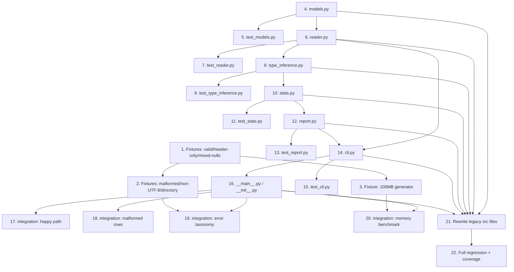

# Implementation Plan: CSV Summary Report Generator

> **Note on existing source**: `src/csv_summary/*.py` already contain legacy files from a prior pipeline run. These files do **not** reflect the finalized architecture (§ 1–7 of `docs/architecture.md`) and must be treated as **stale**. Every implementation task below directs a full rewrite/replacement of the named file(s) to match the finalized component contracts, data flow, and error-handling taxonomy — no assumption of correctness is made about the current file contents.

## Task Table

| # | Task | Type | File(s) | Depends On | Blocked By | Definition of Done |
|---|------|------|---------|------------|------------|-------------------|
| 1 | Create test fixtures: valid CSV, header-only CSV, mixed-nulls CSV | test-fixture | `tests/fixtures/valid_basic.csv`, `tests/fixtures/header_only.csv`, `tests/fixtures/mixed_nulls.csv` | — | — | Three fixture files exist; `valid_basic.csv` has a header + ≥5 data rows spanning numeric, text, and date columns; `header_only.csv` has a header row and zero data rows; `mixed_nulls.csv` has a header + rows containing a mix of empty string, `NA`, `N/A`, `NULL`, `None` (mixed case) across at least one numeric, one text, and one date column |
| 2 | Create test fixtures: malformed-row CSV and error-handling-taxonomy paths (missing file path reference, permission-denied dir, directory-as-file, non-UTF-8 file) | test-fixture | `tests/fixtures/malformed_rows.csv`, `tests/fixtures/not_utf8.csv`, `tests/fixtures/a_directory/` (empty dir used as a "file" path), `tests/fixtures/README.md` | Task 1 | — | `malformed_rows.csv` has a header + rows where ≥2 rows have a field count different from the header; `not_utf8.csv` contains bytes that are not valid UTF-8 (e.g., raw Latin-1 `0xFF` byte sequence) and is NOT decodable via `utf-8-sig`; `a_directory/` exists as an empty directory to be passed as a CLI path to trigger `IsADirectoryError`; `tests/fixtures/README.md` documents each fixture's purpose and which taxonomy row (§ 7 of architecture) or FR it exercises; no fixture path is created for "missing file" or "permission denied" since those are exercised against a deliberately nonexistent path and an OS-level permission-restricted temp file created at test time (not a static fixture) |
| 3 | Create NFR-01 memory-benchmark fixture generator | test-fixture | `tests/fixtures/generate_large_csv.py` | Task 1 | — | Running `python tests/fixtures/generate_large_csv.py` (or importing its public function) deterministically generates a CSV file of configurable target size (default 100MB) with a header containing at least one numeric, one text (including a high-cardinality unique-string column per design-review risk on `stats.py` uniqueness tracking), and one date column, plus a `--rows`/`--size-mb` CLI option; script does not itself exceed O(1) memory while generating (streams writes row-by-row) |
| 4 | Define shared data models, exceptions, and null-token predicate | impl | `src/csv_summary/models.py` | — | — | Module defines `ColumnType` enum (`NUMERIC`, `TEXT`, `DATE`); `RawRow`/`MalformedRow` data classes with explicit field names/types (header-relative field count, raw field list, row number) resolving the design-review's "structurally unspecified" finding; `ColumnStats` variants (or a tagged union) for numeric/text/date; `CsvFileNotFoundError(path: str)` and any other taxonomy exception wrappers from architecture § 7; `is_null_token(value: str) -> bool` implementing FR-04a (empty string and case-insensitive `NA`, `N/A`, `NULL`, `None`); module performs no I/O |
| 5 | Unit tests for `models.py` | test | `tests/unit/test_models.py` | Task 4 | — | Tests cover: `is_null_token` true/false cases for all FR-04a tokens (including mixed case) and non-null values; `RawRow`/`MalformedRow` construction and field access; `CsvFileNotFoundError` carries the original path; all tests pass via `pytest tests/unit/test_models.py -v` |
| 6 | Implement streaming CSV reader with path/encoding validation and malformed-row detection | impl | `src/csv_summary/reader.py` | Task 4 | — | Module exposes `has_data_rows(path: str) -> bool` and a row-streaming generator/function accepting a path (and, per design-review recommendation, optionally an already-open file-like object/factory to support `io.StringIO` injection in unit tests) that: raises `CsvFileNotFoundError` on missing file, lets `PermissionError`/`IsADirectoryError` propagate on `open()` failure, decodes via `utf-8-sig`, raises `UnicodeDecodeError` on invalid byte sequences, yields the header once, then yields each data row as either a well-formed row (list of fields) or a `MalformedRow` (per `models.py`) when field count differs from the header, without ever materializing the full file in memory (FR-02, FR-08, FR-09, FR-10, FR-11; architecture § 7 rows 1–4) |
| 7 | Unit tests for `reader.py` | test | `tests/unit/test_reader.py` | Task 6 | — | Tests (using in-memory `io.StringIO` fixtures plus `tests/fixtures/*.csv`) cover: `has_data_rows` returns `False` for `header_only.csv` and `True` for `valid_basic.csv`; missing-file path raises `CsvFileNotFoundError`; a path in `tests/fixtures/a_directory/` raises `IsADirectoryError`; a permission-restricted temp file (created and chmod'd within the test) raises `PermissionError` on POSIX, or is skipped with a documented `pytest.mark.skipif` on Windows where permission semantics differ; `not_utf8.csv` raises `UnicodeDecodeError`; `malformed_rows.csv` yields `MalformedRow` instances for the mismatched rows and plain rows otherwise, with correct 1-indexed-over-data-rows row numbers; all tests pass via `pytest tests/unit/test_reader.py -v` |
| 8 | Implement per-column type inference pass | impl | `src/csv_summary/type_inference.py` | Task 6 | — | Module exposes `infer_types(path: str) -> dict[str, ColumnType]` (or equivalent accepting an injected row source per design-review recommendation) that opens a fresh stream via `reader.py`, applies `models.is_null_token` to skip nulls per column, counts values parsing as ISO 8601 date (`date.fromisoformat`/`datetime.fromisoformat`) vs. int/float vs. neither, and classifies each column as `DATE`/`NUMERIC`/`TEXT` using the 90% threshold rule (FR-04), defaulting to `TEXT` when a column has zero non-null values |
| 9 | Unit tests for `type_inference.py` | test | `tests/unit/test_type_inference.py` | Task 8 | — | Tests cover: a column with ≥90% ISO date values classified `DATE`; a column with ≥90% numeric values classified `NUMERIC`; a column below both thresholds classified `TEXT`; a column that is all-null classified `TEXT` without raising; mixed date-only and datetime values within one column both counted toward the date threshold; uses `valid_basic.csv` and `mixed_nulls.csv` fixtures; all tests pass via `pytest tests/unit/test_type_inference.py -v` |
| 10 | Implement streaming statistics aggregation pass | impl | `src/csv_summary/stats.py` | Task 8 | — | Module exposes `compute_stats(path: str, column_types: dict[str, ColumnType]) -> tuple[int, dict[str, ColumnStats]]` (or equivalent accepting an injected row source) that opens a second fresh stream via `reader.py`, counts every row (including malformed) toward `row_count`, emits a stderr warning identifying the 1-indexed data-row number for each `MalformedRow` and excludes it from column stats, parses each well-formed cell per its column's inferred type treating unparsable individual values as null (NFR-03), and accumulates: numeric columns — running min/max/mean (float-based) and null count in O(1) memory; text columns — exact unique-value `set` and null count; date columns — earliest/latest (`date`/`datetime`, date-only treated as midnight) and null count; no row-level data retained after processing (FR-03, FR-05, FR-06, FR-07, FR-11, NFR-01) |
| 11 | Unit tests for `stats.py` | test | `tests/unit/test_stats.py` | Task 10 | — | Tests cover: numeric column min/max/mean/null-count correctness against hand-computed expected values; text column unique-count/null-count correctness including duplicate and null handling; date column earliest/latest/null-count correctness including mixed date-only/datetime inputs; malformed rows from `malformed_rows.csv` counted in `row_count` but excluded from per-column stats, with a stderr warning emitted (captured via `capsys`) naming the correct row number; unparsable individual cell values (e.g., text in a numeric column) treated as null rather than raising; all tests pass via `pytest tests/unit/test_stats.py -v` |
| 12 | Implement plain-text report renderer | impl | `src/csv_summary/report.py` | Task 10 | — | Module exposes `render(row_count: int, column_stats: dict[str, ColumnStats]) -> str` producing one section per column with its inferred type and relevant stats (min/max/mean/null-count for numeric; unique-count/null-count for text; earliest/latest/null-count for date), rendering whole numeric values without a trailing `.0` and non-whole values in fixed-point form, rendering date-only earliest/latest as `YYYY-MM-DD` and switching to full `YYYY-MM-DDTHH:MM:SS` only when the column mixes date-only and datetime values, and never emitting JSON or another structured format (FR-03, FR-05–FR-07, FR-12) |
| 13 | Unit tests for `report.py` | test | `tests/unit/test_report.py` | Task 12 | — | Tests cover: whole-number numeric values rendered without `.0` and fractional means rendered in fixed-point form; date-only column rendered as `YYYY-MM-DD`; mixed date/datetime column rendered with full `YYYY-MM-DDTHH:MM:SS`; output contains one section per column and the total row count; output is plain text (no `{`/`[` JSON structure present); all tests pass via `pytest tests/unit/test_report.py -v` |
| 14 | Implement CLI entry point with top-level error-handling boundary | impl | `src/csv_summary/cli.py` | Task 6, Task 12 | — | Module exposes `main(argv: list[str] | None = None) -> int` that: parses a single required positional CSV path argument via `argparse` (FR-01); calls `reader.has_data_rows`, printing `"No data rows found"` to stdout and returning 0 if no data rows exist (FR-09); otherwise runs `type_inference.infer_types` → `stats.compute_stats` → `report.render` and prints the result to stdout, returning 0; wraps the entire pipeline in the single outer `try/except` from architecture § 7 ("`cli.py` Top-Level Boundary (Confirmed)"), catching `CsvFileNotFoundError`, `PermissionError`, `IsADirectoryError`, `UnicodeDecodeError`, then a generic `Exception` catch-all last, each printing the exact stderr message pattern from the § 7 Taxonomy Table and returning exit code 1; no exception can surface as a raw traceback |
| 15 | Unit tests for `cli.py` | test | `tests/unit/test_cli.py` | Task 14 | — | Tests invoke `cli.main([path])` directly (capturing stdout/stderr/return code via `capsys`) for each of: valid file → exit 0 with report text on stdout; `header_only.csv` → exit 0 with `"No data rows found"` on stdout; nonexistent path → exit 1 with `"Error: file not found: '<path>'"` on stderr; `tests/fixtures/a_directory/` → exit 1 with `"Error: '<path>' is a directory, not a file"`; `not_utf8.csv` → exit 1 with `"Error: '<path>' is not valid UTF-8 text..."`; a permission-restricted temp file (POSIX only, skipped on Windows) → exit 1 with `"Error: permission denied reading '<path>'"`; a monkeypatched pipeline stage raising a generic `RuntimeError` → exit 1 with `"Error: an unexpected error occurred: ..."` ; all tests pass via `pytest tests/unit/test_cli.py -v` |
| 16 | Implement `python -m csv_summary` module entry point and package init | impl | `src/csv_summary/__main__.py`, `src/csv_summary/__init__.py` | Task 14 | — | `__main__.py` calls `sys.exit(cli.main())` when executed; `__init__.py` exposes the package version/public re-exports (if any) needed by tests, with no executable side effects beyond imports; running `python -m csv_summary tests/fixtures/valid_basic.csv` from the repo's `src/` on `PYTHONPATH` exits 0 and prints a report to stdout |
| 17 | Integration test: end-to-end happy path and FR-04–FR-07 type/stat coverage | test | `tests/integration/test_end_to_end_happy_path.py` | Task 16 | — | Test invokes the tool as a subprocess (`python -m csv_summary <path>`, with `src/` on `PYTHONPATH`) against `valid_basic.csv` and `mixed_nulls.csv`, asserting exit code 0, correct total row count in stdout, one section per column with the expected inferred type, and correct min/max/mean/unique/earliest/latest/null-count values matching hand-computed expectations for each fixture; test passes via `pytest tests/integration/test_end_to_end_happy_path.py -v` |
| 18 | Integration test: malformed-row handling end-to-end (FR-11) | test | `tests/integration/test_malformed_rows.py` | Task 16 | — | Test invokes the tool as a subprocess against `malformed_rows.csv`, asserting exit code 0, stdout's total row count includes the malformed rows, stdout's per-column stats exclude values from malformed rows, and stderr contains a warning line per malformed row naming the correct 1-indexed data-row number; test passes via `pytest tests/integration/test_malformed_rows.py -v` |
| 19 | Integration test: full error-handling taxonomy end-to-end (architecture § 7, FR-08/FR-09) | test | `tests/integration/test_error_handling.py` | Task 16, Task 2 | — | Test invokes the tool as a subprocess for each of: nonexistent path (exit 1, taxonomy row 1 message), `tests/fixtures/a_directory/` (exit 1, taxonomy row 3 message), `not_utf8.csv` (exit 1, taxonomy row 4 message), permission-restricted temp file (exit 1, taxonomy row 2 message, POSIX only/skipped on Windows), `header_only.csv` (exit 0, `"No data rows found"`); every stderr message matches the exact pattern from architecture § 7's Taxonomy Table; test passes via `pytest tests/integration/test_error_handling.py -v` |
| 20 | Integration test: NFR-01 100MB / 512MB peak-RSS memory benchmark | test | `tests/integration/test_memory_benchmark.py` | Task 16, Task 3 | — | Test generates (or reuses a cached) ~100MB CSV via `tests/fixtures/generate_large_csv.py`, runs the tool as a subprocess while sampling the child process's peak RSS (e.g., via `resource.getrusage(resource.RUSAGE_CHILDREN)` on POSIX or `psutil`/`Get-Process` equivalent on Windows, matching whatever measurement approach the `verification` step standardizes on), asserts the process exits 0 and peak RSS stays ≤ 512MB, and asserts the high-cardinality unique-text column's unique count is correct, empirically confirming the design-review's accepted exact-`set` memory bound holds in practice; test may be marked `@pytest.mark.slow` to allow exclusion from fast local runs but MUST run in the `verification` pipeline step; test passes via `pytest tests/integration/test_memory_benchmark.py -v -m slow` |
| 21 | Rewrite/replace stale legacy source files to match finalized architecture | impl | `src/csv_summary/__init__.py`, `src/csv_summary/__main__.py`, `src/csv_summary/cli.py`, `src/csv_summary/models.py`, `src/csv_summary/reader.py`, `src/csv_summary/type_inference.py`, `src/csv_summary/stats.py`, `src/csv_summary/report.py` | Task 4, Task 6, Task 8, Task 10, Task 12, Task 14, Task 16 | — | Every legacy file under `src/csv_summary/` from the prior pipeline run has been fully replaced by the implementations produced in Tasks 4, 6, 8, 10, 12, 14, and 16 (no leftover prior-run code paths, signatures, or behaviors remain); `grep`-style check confirms no references to any pre-existing function/class signatures that are incompatible with the models/contracts defined in Task 4; all unit and integration tests from Tasks 5, 7, 9, 11, 13, 15, 17–20 pass against the rewritten files |
| 22 | Full-suite regression run and coverage check | test | — (no new files; runs existing suite) | Task 21 | — | `pytest tests/unit/ tests/integration/ --cov=src/csv_summary --cov-report=term-missing` runs with zero failures and reports coverage ≥ 80% across `src/csv_summary/`; any `@pytest.mark.slow` benchmark test (Task 20) is included in this run at least once before sign-off |

## Dependency Graph

Linear critical path (longest chain): `1 → 4 → 6 → 8 → 10 → 12 → 14 → 16 → {17,18,19,20} → 21 → 22`.

## Blocked Tasks
None.

## Definition of Done — Full Pipeline

- All 22 tasks in the Task Table are marked complete, including the full rewrite of stale legacy files (Task 21).
- All unit tests pass: `pytest tests/unit/ -v`.
- All integration tests pass: `pytest tests/integration/ -v`, including the NFR-01 memory benchmark (Task 20).
- Test coverage ≥ 80% across `src/csv_summary/`: `pytest --cov=src/csv_summary --cov-report=term-missing`.
- No bare `except:` clauses anywhere in `src/csv_summary/`; all exception handling matches the ordered, specific-to-generic pattern in architecture § 7.
- All public functions in `src/csv_summary/*.py` have complete type hints (parameters and return types).
- No hardcoded secrets, credentials, or network calls anywhere in `src/csv_summary/`.
- No raw Python traceback can reach the user under any input condition covered by the error-handling taxonomy (architecture § 7, Tasks 15/19).
- The NFR-01 benchmark (Task 20) empirically confirms peak RSS ≤ 512MB for a 100MB input file, including a high-cardinality unique-text column.
- `docs/impl-plan.md` task statuses and `docs/changelog.md` are updated to reflect completion before proceeding to `code-review`.
